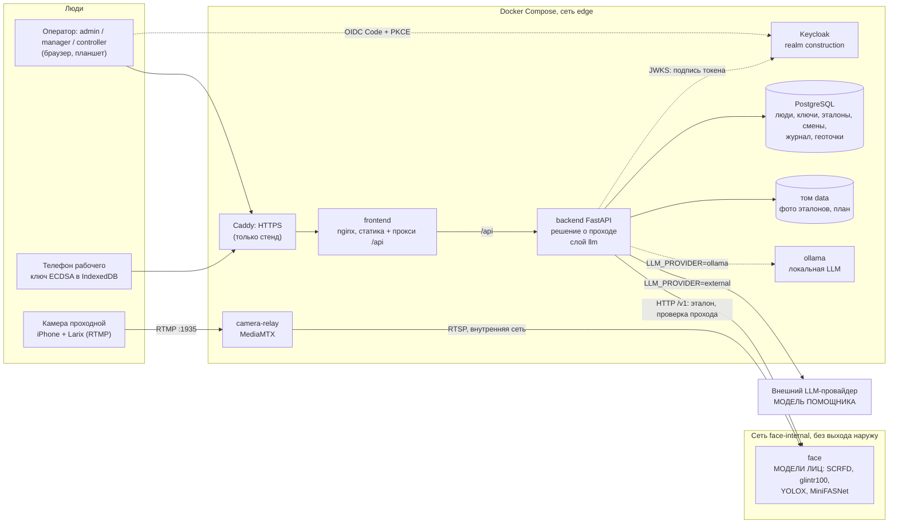

# Схема решения

Состояние на 10.10.2026, `main` на `0cc94d4`. Пунктир на схеме — то, чего ещё нет в `compose.yaml` или что не подтверждено сквозным прогоном. Устройство самого фронтенда: [frontend/docs/architecture.md](../frontend/docs/architecture.md).

## Где вызываются модели

| Модель | Где работает | Кто вызывает | Что делает |
| --- | --- | --- | --- |
| Лица: SCRFD det_10g (детектор), ArcFace glintr100 (сравнение 1:1, порог 0,68), YOLOX-S (подсчёт людей), MiniFASNet (живость) | контейнер `face`, локально, без облачных API | только `backend` по HTTP (`FACE_URL`), контракт [face/docs/api.md](../face/docs/api.md) | проверяет пригодность эталона при регистрации и сравнивает лицо с эталоном именно этого человека при проходе. Возвращает факты и `status` |
| LLM помощника: внешний сервис или Ollama (`qwen2.5:7b`) | снаружи или контейнер `ollama` (в `compose.yaml`, профиль `backend`) | только слой `backend/app/llm/`, провайдер задаётся `LLM_PROVIDER` | формулирует ответ и сводку по цифрам, которые посчитала система |

Больше нигде модели не вызываются: фронтенд ни `face`, ни LLM не видит.

## Кто с кем общается

- **Браузер → frontend → backend.** Все операции под префиксом `/api`. Фронт не присылает `match`, `verified`, `allowed`.
- **Операторы → Keycloak.** Authorization Code + PKCE, клиент `panel`. Backend проверяет подпись токена по JWKS, `exp`, `iss`, `aud` и роль. Рабочих в Keycloak нет.
- **Телефон рабочего → backend.** Привязка по одноразовому enroll-коду (`POST /api/enroll`). Дальше телефон подписывает запрос `POST /api/device/pass-code` своим ключом ECDSA и получает одноразовый 6-значный код сессии. Закрытый ключ не покидает устройство.
- **Контролёр → backend (проход).** Контролёр сверяет удостоверение, выбирает человека и создаёт сессию (`POST /api/passages`), вводит код, который назвал рабочий (`/api/passages/{id}/code`), затем отправляет 1–5 кадров лица (`/api/passages/{id}/face`). Статусы сессии меняются атомарно: `pending → signed → decided`.
- **backend → face.** Единственный клиент модуля. Любая ошибка, таймаут (5 с) или недоступность модуля означает отказ.
- **Камера → camera-relay → face.** Поток идёт мимо браузера, поэтому в режиме камеры кадр нельзя подменить инструментами разработчика. В текущем потоке прохода кадры присылает браузер контролёра, и эта защита от подмены кадра на нём не держится: её заменяют проверки модуля (кадр не равен эталону, повтор кадра, живость), см. [limitations.md](limitations.md). Режим «камера» (`verify/camera`) бэкенд пока не вызывает (в PRD помечен как будущий): проход идёт через `POST /v1/verify/frames` с кадрами, которые контролёр отправил с фронта. `camera-relay` и консоль модуля работают на стенде отдельно, для просмотра и проверки.
- **backend → llm → провайдер.** Слой `llm` получает от бэкенда готовые факты из `repositories/queries.py` и отвечает текстом. Цифры в ответ добавляет система, а не модель.

## Где хранятся данные

| Данные | Место |
| --- | --- |
| Люди, группы, открытые ключи устройств, коды активации, эмбеддинги эталонов с `model_version`, попытки прохода, смены, журнал `access_events`, геоточки | PostgreSQL, том `pgdata` |
| Фото эталонов, план объекта | том `data` (`/data` в `backend`) |
| Операторы и роли | Keycloak, встроенная БД `dev-file`, том `keycloak_data` |
| Эмбеддинги и кадры в модуле лиц | не хранятся: у `face` своего хранилища нет, кроме защиты от повтора кадров в памяти процесса |

## Что не подтверждено

- Проход (код, подпись телефона, проверка лица) и вход операторов `/api/auth/*` уже в `main` (PR #6, `0cc94d4`). Схема соответствует `backend/README.md` и контракту `face`; живой сквозной прогон на стенде с людьми не подтверждён.
- Сервиса `ollama` в `compose.yaml` нет (нужен от DevOps), слой `llm` с провайдерами `external` и `ollama` в `main`, но на стенде модель не подключена.
