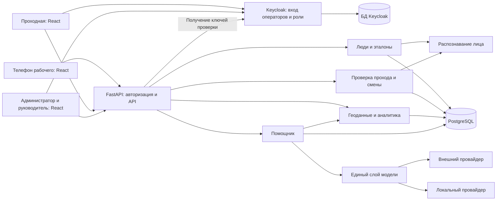

# Как должна работать «Проходная»

Статус: проект взаимодействий и пользовательских историй, а не описание уже реализованной системы. Основание — [условия кейса](../case_prerekvizity/Кейс_1_Проходная_v2_КОТИК_на_ТРОНЕ.md). Стек команды: React, FastAPI, PostgreSQL, Docker Compose. Дополнительное требование пользователя: использовать Keycloak или аналогичный сервер идентификации. В проекте выбираем Keycloak; замена возможна совместимым OIDC-провайдером с сохранением описанных свойств. В исходном кейсе это требование явно не указано. Согласованные протоколы описаны ниже по переданным решениям команды; детали сверяются с файлами 00–08 при их получении.

## 1. Общий процесс

Подготовить площадку и зоны → зарегистрировать человека и проверить эталон лица → привязать телефон → проверить вход → открыть смену → собирать перемещения → проверить выход → закрыть смену → построить отчёты и ответы помощника.

Отчёты и список присутствующих доступны уже во время смены. Не нужно ждать выхода, чтобы увидеть обстановку. Каждый отказ также является событием системы и сохраняется в журнале.

Роли, матрица прав, навигация и экраны React подробно описаны в [спецификации интерфейсов](roles-and-interfaces.md). При разработке прав и UI используй её как единый перечень.

## 2. Компоненты и ответственность

| Компонент | Что делает | Чему не является источником доверия |
| --- | --- | --- |
| React: рабочий | Подтверждение с телефона, состояние смены, передача координат | Не определяет свою личность простым `person_id` и не открывает смену самостоятельно |
| React: проходная | Инициирует вход/выход, получает кадр камеры, показывает серверное решение | Не отправляет готовое разрешение или доверенный результат сравнения лица |
| React: администратор/руководитель | Люди, эталоны, план, журнал, отчёты, помощник | Не рассчитывает окончательные бизнес-показатели вместо сервера |
| Keycloak | Вход, аккаунты, роли, сессии, выдача токенов OIDC | Не подтверждает физическую личность на проходной |
| FastAPI: авторизация | Проверяет access token и роли операторов либо подписи рабочего, затем доступ к данным | Не доверяет роли или идентификатору пользователя из тела запроса |
| FastAPI: управление людьми | Регистрация, правка, проверка пригодности эталона, привязка телефона | Не принимает непригодное фото как действующий эталон |
| FastAPI: проход и смены | Координирует подтверждение и лицо, принимает решение, меняет смену | Не делегирует решение контролёру или генеративной модели |
| Модуль распознавания лица | Проверяет пригодность эталона и сравнивает кадр с эталоном человека | Обнаружение лица само по себе не подтверждает личность |
| FastAPI: геоданные и аналитика | Проверяет точки, связывает их со сменой и зоной, считает отчёты | Не считает отсутствие координат доказательством выхода |
| FastAPI: общий слой модели | Вызывает выбранного провайдера, формирует ответ по проверенным данным | Генеративная модель не источник чисел и не принимает решение о проходе |
| PostgreSQL | Хранит сущности, события, настройки и ограничения целостности | Наличие БД само по себе не заменяет серверную проверку |

Модули FastAPI — части одного бэкенда для MVP. Не требуется отдельный контейнер для каждого модуля. Распознаватель можно подключить внутри бэкенда; если выбран отдельный сервис, только бэкенд обращается к нему.



Четыре основных контейнера: `frontend`, `backend`, `db`, `keycloak`. Предпочтительно использовать в PostgreSQL две отдельные базы и роли доступа: приложения и Keycloak; встроенная persistent БД start-dev допустима как документированный вариант стенда. Бэкенд не читает внутренние таблицы Keycloak, а Keycloak не владеет таблицами смен и рабочих. Локальный сервис генеративной модели — дополнительный сервис при выборе локального провайдера. Внешний провайдер находится вне Compose. Браузеры загружают React из frontend и обращаются к backend; PostgreSQL доступен backend, а не браузерам. Постоянные данные сохраняются вне жизненного цикла контейнера БД.

## 3. Запуск и подготовка объекта

1. Запускается PostgreSQL с постоянным volume; проверяется готовность принимать соединения.
2. Применяются миграции схемы. До их успешного завершения бэкенд не считается готовым к работе.
3. Запускается Keycloak со своей постоянной БД; применяются воспроизводимые настройки realm, OIDC-клиента и ролей. Затем запускается FastAPI с настройками доверенного issuer, audience, подключения, распознавателя и выбранного провайдера модели.
4. Становится доступен React с интерфейсами ролей. Ошибка модели не должна блокировать регистрацию, проходы и отчёты.
5. Администратор входит, создаёт/настраивает площадку, загружает подготовленную по материалам кейса план-схему, задаёт зоны и привязку координат через UI.
6. Бэкенд проверяет настройки и сохраняет их в БД. У отчётов и приёма координат один способ определения зоны.

Первоначальный технический администратор Keycloak и пользователь приложения с ролью `admin` — разные назначения; их создание описывается отдельно. Пароли задаются конфигурацией. Хранение изображений и миграции сверяются с принятыми решениями 01–08. Секреты поступают из конфигурации и не хранятся в репозитории.

## 3.1. Вход операторов и регистрация рабочего

Keycloak используется только администратором, руководителем и контролёром: realm `construction`, роли `admin`, `manager`, `controller`, public client `panel`, audience `access-api`. React выполняет Code Flow + PKCE S256; FastAPI проверяет access token по JWKS, exp, iss, aud и ролям. Подробнее: [аутентификация](authentication.md).

Рабочий не входит в Keycloak и не получает аккаунт через Admin API. Администратор создаёт человека с проверенным эталоном → выпускает одноразовый enroll-код → телефон сканирует код и создаёт неизвлекаемый ECDSA-ключ → `/enroll` регистрирует открытый ключ и атомарно гасит код. Дальше сервер узнаёт рабочего по проверенной подписи.

Физический проход требует подписи свежего nonce с привязкой к попытке/направлению и сравнения лица. Контракты подписи и обмена определены командой в 01–08; эти файлы пока отсутствуют в checkout, поэтому конкретные поля не додумываются. Защита от повторного применения обязательна, неизвлекаемость ключа не заменяет проверку всей цепочки.

## 5. Вход: порядок взаимодействия

```mermaid
sequenceDiagram
    actor C as Контролёр
    participant G as React проходной
    participant W as React телефона
    participant B as FastAPI
    participant F as Распознавание лица
    participant D as PostgreSQL
    Note over G,B: Контролёр авторизован access token Keycloak; рабочий подписывает nonce
    C->>G: Начать вход
    G->>B: Создать попытку входа
    B->>D: Сохранить ожидающую попытку
    B-->>G: Идентификатор попытки
    W->>B: Запросить подтверждение этой попытки
    B-->>W: Одноразовый запрос
    W->>B: Предъявить доказательство
    G->>B: Передать кадр для этой попытки
    B->>D: Получить привязку и эталон
    B->>F: Сравнить кадр с эталоном человека
    F-->>B: Результат сравнения
    B->>B: Проверить доказательство и правила входа
    alt Все проверки успешны
        B->>D: Атомарно погасить подтверждение, разрешить попытку и открыть смену
        B-->>G: Разрешён вход
        B-->>W: Состояние: смена открыта
    else Отказ или ошибка проверки
        B->>D: Сохранить отказ или ошибку с причиной
        B-->>G: Причина отказа или ошибки
    end
```

Диаграмма задаёт логический обмен, а не окончательный API. Телефон связывается с попыткой по выбранному командой протоколу и подписывает nonce её сессии; точный обмен сверяется с 01–08. Такой идентификатор связывает устройства, но сам не является доказательством личности. Ответы телефона и проходной могут приходить в любом порядке; сервер принимает решение только после получения обоих и не смешивает разные попытки. Обновление экранов может выполняться запросом статуса; push-обновления не обязательны.

Перед финализацией сервер повторно проверяет срок, отсутствие потребления, человека, направление, актуальность привязки и состояние смены. Долгое распознавание выполняется вне транзакции, финальная проверка и изменение состояния — в короткой транзакции с защитой от гонок.

Обязательные ветки отказа: чужое лицо, непригодный кадр, неверное/истёкшее/повторное подтверждение, подмена попытки, деактивированный человек, недоступность проверки. Предлагаемое правило MVP: повторный вход при открытой смене отклоняется. Все отказы видны в журнале; ни один не открывает смену.

Повтор доставки одного HTTP-запроса возвращает прежний результат без новой смены. Новая попытка предъявить уже использованное доказательство отклоняется и журналируется. При падении процесса незавершённая попытка не становится разрешённой автоматически.

## 6. Открытая смена и перемещения

1. Телефон узнаёт от сервера, что смена открыта, и получает её идентификатор.
2. Отправляет подписанные ECDSA-пачки в `POST /locations`: координаты, время измерения, точность и данные защиты от повтора. Интервал должен позволять увидеть маршрут на защите и иметь объяснимый расход батареи.
3. FastAPI проверяет подпись ключа рабочего, принадлежность смены, корректность данных и факт, что смена ещё открыта. Поле `person_id` клиента не определяет владельца точки.
4. Сервер переводит координаты в систему плана, определяет зону по сохранённым правилам и сохраняет точку со временем получения. Повторная доставка не создаёт дубль.
5. Руководитель запрашивает присутствующих и последние координаты. FastAPI читает БД и возвращает состояние с временем последнего обновления.

Потеря связи или разрешения геолокации отображается как отсутствие свежих данных; человек остаётся внутри, пока не зарегистрирован выход. После закрытия смены сервер не принимает в неё новые точки, даже если телефон продолжает отправку. Приём точки и закрытие должны быть согласованы транзакционно.

Для демонстрации разрешён симулятор. Его точки проходят те же серверные проверки, сохраняются в БД и помечаются `source=sim`, обычные точки — `source=phone`. Симулятор регистрирует виртуальные ECDSA-ключи через `/enroll` и отправляет подписанные пачки `/locations`, без прямой записи в БД; интервал около 30 секунд с возможностью ускорения. Открытие тестовых смен согласуется с backend и показывается судьям. Нарисованный маршрут без событий в БД не подходит.

## 7. Выход и отчёт по смене

Контролёр инициирует новую попытку с направлением «выход» → телефон предъявляет новое доказательство → камера передаёт новый кадр → сервер выполняет те же проверки личности → при успехе атомарно фиксирует разрешение и закрывает открытую смену.

Время окончания задаёт сервер. Длительность рассчитывается по сохранённым началу и концу. После коммита человек исчезает из списка присутствующих, телефон прекращает сбор, а история остаётся доступна в отчётах. Предлагаемое правило MVP: выход без открытой смены отклоняется с понятной причиной. Отказ на выходе не закрывает смену.

## 8. Аналитика и помощник

### Аналитика

Руководитель выбирает день/диапазон дней, часы внутри дня и людей → React передаёт фильтры FastAPI → сервер применяет общий часовой пояс и границы периода → PostgreSQL возвращает события → сервер считает выбранную метрику и маршруты → React показывает их на плане.

Обязательны: нулевые и малопосещаемые зоны визуально различаются; маршруты упорядочены, люди имеют разные обозначения и легенду; одинаковые фильтры действуют на оба представления. Метрика выбирается командой и одинаково называется в интерфейсе, документации и расчётах. Отдельно доступны отчёт по смене и по человеку за период.

### Помощник

1. Руководитель отправляет вопрос или запрос сводки за период.
2. FastAPI проверяет права и определяет, какие факты нужны. Если запрос неоднозначен, запрашивает уточнение либо явно сообщает выбранный период.
3. Общий модуль отчётов получает данные из PostgreSQL и считает показатели. Определение показателя важно: «больше людей» — не то же самое, что «больше координатных точек».
4. Единый слой модели передаёт выбранному провайдеру проверенные факты и сохранённый в репозитории шаблон запроса.
5. Модель формулирует ответ; сервер проверяет допустимость результата и возвращает ответ, период и показатели. Механизм защиты от выдуманных чисел сверяется с решениями 06–07; детали этих отсутствующих файлов не реконструируются. Одного обещания в промпте недостаточно.
6. Если данных нет, показывается прямой ответ об отсутствии данных. Таймаут и неверный формат дают понятную ошибку и возможность повторить; фиктивный успешный ответ запрещён.

Обязательные вопросы: кто сейчас внутри; кто вчера отработал меньше четырёх часов; в какой зоне вчера было больше всего людей; были ли отказы за неделю и почему. Сводка содержит людей, смены, отклонения, отказы и аномалии, если их можно установить по данным и определённым правилам.

Внешний и локальный провайдеры реализуют один контракт. Провайдер, адрес и модель выбираются конфигурацией; переключение демонстрируется реальным запросом. Локальный режим позволяет не передавать персональные данные внешней модели и не должен скрыто переключаться на внешний сервис при сбое.

## 9. Состояния, которые видит пользователь

| Объект | Состояния | Кто меняет |
| --- | --- | --- |
| Попытка прохода | Ожидает данных → проверяется → разрешена / отказ / ошибка | Только сервер; истечение ожидания не даёт разрешения |
| Смена | Нет открытой → открыта → закрыта | Только успешные серверные проверки входа/выхода |
| Телефон | Не привязан → привязан → доступ отозван | Контролируемые серверные операции |
| Геолокация | Нет данных / свежие данные / устаревшие данные / нет разрешения | Сервер определяет давность; клиент сообщает локальные ограничения |
| Запрос помощнику | Выполняется → готов / нет данных / ошибка | Сервер и единый слой модели |

Это предлагаемые состояния UI. Точный словарь и формат API согласуются перед разработкой. Во всех интерфейсах нужны ожидание, понятная ошибка и действие для восстановления.

## 10. Пользовательские истории и критерии приёмки

Все истории US ниже составлены командой по кейсу; они не являются официальной нумерацией сценариев С1–С22. «Обязательно» означает обязательный объём решения, а не требование реализовать всё одновременно.

| ID | История | Критерии приёмки | Основание |
| --- | --- | --- | --- |
| US-01 | Как администратор, я хочу зарегистрировать рабочего, чтобы система узнавала его на проходной | Через UI сохраняются данные и пригодный эталон; фото без лица/с несколькими людьми отклоняется; работает для нового человека судей | 3.1, Д9 |
| US-02 | Как администратор, я хочу редактировать людей, чтобы сведения оставались актуальными | Правка доступна через UI; замена эталона проходит ту же проверку; значимое действие журналируется | 4, 5.1 |
| US-03 | Как рабочий, я хочу один раз привязать телефон, чтобы предъявлять подтверждение при проходах | Средство связано с конкретным человеком; для нового прохода требуется новое доказательство; копирование и пересылка не дают пройти за другого | 3.1–3.2 |
| US-04 | Как контролёр, я хочу проверить вход, чтобы пропускать только установленного человека | Получены подтверждение телефона и кадр; сервер проверил оба; разрешение и открытие смены сохранены вместе | 3.2, Д2, Д10 |
| US-05 | Как контролёр, я хочу понимать отказ, чтобы объяснить человеку дальнейшие действия | Чужое лицо, истёкшее доказательство и ошибки проверки дают понятную причину; попытка в журнале, смена не открыта | 3.2, 5.2 |
| US-06 | Как рабочий, я хочу передавать местоположение во время смены, чтобы мой маршрут учитывался | Точки привязаны к моей открытой смене; повтор не дублируется; после закрытия сервер их не принимает | 3.3 |
| US-07 | Как контролёр и рабочий, мы хотим подтверждать выход, чтобы корректно завершать смену | Новая проверка телефона и лица; успех закрывает смену, считает время и убирает человека из присутствующих; отказ сохраняет смену открытой | 3.4 |
| US-08 | Как администратор, я хочу видеть журнал, чтобы разбирать спорные проходы | Доступны успехи, отказы и ошибки, время, направление, установленный человек и причина; неопознанная попытка не теряется | 3.5, 5.1 |
| US-09 | Как руководитель, я хочу видеть людей на объекте, чтобы понимать текущую обстановку | Список строится по открытым сменам и содержит время входа; устаревшая геолокация обозначена отдельно | 4, пункт 5 |
| US-10 | Как администратор, я хочу настроить план и зоны, чтобы координаты попадали на схему | План подготовлен по материалам кейса; привязка и зоны задаются через UI, сохраняются; один способ классификации во всех отчётах | 4.1, 5.3 |
| US-11 | Как руководитель, я хочу сравнивать посещаемость зон, чтобы видеть загруженные и пустые места | Период и метрика явны; ноль отличается от малой активности; цифры получены из сохранённых событий | 4.1 |
| US-12 | Как руководитель, я хочу смотреть маршруты людей, чтобы понимать перемещения | Есть последовательность точек, различимые люди и легенда; день/диапазон/часы/выбор людей одинаково фильтруют маршруты и зоны | 4.1 |
| US-13 | Как руководитель, я хочу отчёты по смене и человеку за период, чтобы разбирать отработанное время | Отчёты используют реальные начало/конец и точки; определены границы периода, часовой пояс и обработка незавершённых смен | 4, пункт 6 |
| US-14 | Как руководитель, я хочу задавать вопросы обычным языком, чтобы получать факты без ручного поиска | Работают четыре обязательных типа вопросов; модель реально вызывается; числа совпадают с отчётами; отсутствие данных прямо обозначено | 4.2, Д5 |
| US-15 | Как руководитель, я хочу получить сводку за период, чтобы отправить её заказчику | Ответ содержит проверяемые показатели людей, смен и отказов; отклонения/аномалии основаны на данных; ошибки модели не выдают выдуманную сводку | 4.2, 5.3 |
| US-16 | Как команда заказчика, мы хотим переключить модель на локальную, чтобы работать без внешней передачи данных | Два рабочих провайдера, единый слой вызова, конфигурация, файлы запуска и отдельная инструкция; переключение показано запросом | 5.3, Д6 |
| US-17 | Как пользователь, я хочу продолжить работу после перезапуска, чтобы история не потерялась | Люди, эталоны, смены, план, координаты и журнал доступны после перезапуска; незавершённая проверка не превращается в разрешение | 5.1, Д4 |
| US-18 | Как судья, я хочу запустить и проверить решение, чтобы оценить его без помощи команды | Есть инструкция с настройками и входом, схема, 3–6 решений, локальная инструкция, ограничения и отчёт об ИИ; весь сценарий выполняется через собственные UI | 5.5, Д1, Д3, Д8 |
| US-19 | Как оператор, я хочу входить через единый сервис, чтобы получать доступ по своей роли | Вход через Keycloak, выход и обновление токена работают; FastAPI отклоняет неверный issuer/audience, просроченный токен и чужие данные; пароли не хранятся приложением | Дополнительное требование пользователя |

### Сквозные условия готовности каждой истории

- Права проверяются сервером; изменение страницы или запроса не обходит бизнес-правила.
- Данные реальны и сохраняются постоянно; ошибки не маскируются демонстрационными значениями.
- Успех, ожидание, отказ и восстановление понятны пользователю соответствующего устройства.
- Есть проверка успешного сценария и существенных отрицательных веток; результаты проверок не выдуманы.
- Секреты отсутствуют в репозитории; команда может объяснить и изменить код.

## 11. В каком порядке разрабатывать

| Шаг | Что сделать | Зависимости и результат |
| --- | --- | --- |
| 1 | Сверить выбранный протокол ECDSA, распознаватель, состояния и API с 01–08 | Сначала доказать принципиальную возможность серверной защиты; без этого нельзя считать проход решённым |
| 2 | Поднять Compose, PostgreSQL, Keycloak, миграции, FastAPI и React; настроить OIDC и роли | Минимальное соединение UI → API → БД, постоянное хранение и инструкция запуска |
| 3 | Сделать регистрацию с настоящей проверкой эталона и привязку телефона | US-01–03; новый человек создаётся через UI, без ручных запросов |
| 4 | Собрать вертикальный сценарий входа и выхода с журналом и защитой от повторов | US-04–05, US-07–09; серверная проверка чужого лица, гонок и повторных подтверждений |
| 5 | Настроить план, зоны, сбор и имитацию координат | US-06, US-10; события относятся только к открытой смене |
| 6 | Сделать общие расчёты и экраны аналитики | US-11–13; известный набор событий даёт ожидаемые маршруты и числа |
| 7 | Подключить помощника к тем же расчётам; реализовать оба провайдера | US-14–16; интеграцию провайдеров можно начинать после шага 2, итог зависит от данных шагов 4–6 |
| 8 | Пройти полный сценарий на новых данных, перезапуск и ошибки; закончить документацию | US-17–18 и сверка Д1–Д11; живой прогон, включая переключение модели |

Документацию, журнал решений и осмысленные коммиты вести на всех шагах. Бонусы — уведомления, push-обстановка, график, экспорт и другие — рассматривать после обязательного объёма. Отдельная промышленная инфраструктура и нативные приложения не нужны.

## 12. Принятые решения и сверка спецификации

- Рабочий: одноразовый enroll-код → неизвлекаемый ECDSA-ключ → подпись nonce прохода и пачек координат. Пароля и аккаунта Keycloak нет.
- Операторы: Keycloak, три realm-роли, `panel`, audience `access-api`; токены в памяти, срок около пяти минут.
- План меняет `admin`; `manager` читает. Администратор видит аналитику. Деактивация при открытой смене отклоняется.
- Повтор того же HTTP-действия возвращает решение сессии, но не создаёт повторного перехода смены. Новое предъявление использованного nonce отклоняется.
- Сиды и симулятор используют вымышленных людей и помеченные точки, реальный API, без прямых записей в БД.
- Исходный DOCX и согласованные 00–08 — источник требований и архитектурных решений. В текущем checkout 00–08 отсутствуют; формат подписей, параметры распознавания, метрика/калибровка и контракт модели сверяются с ними при получении. Не считать отсутствие файлов разрешением выбрать другой протокол.

Сценарии пользовательских историй превращены в [чек-лист самопроверки](acceptance-checklist.md). Отметки готовности проставляются только по реальному прогону.
