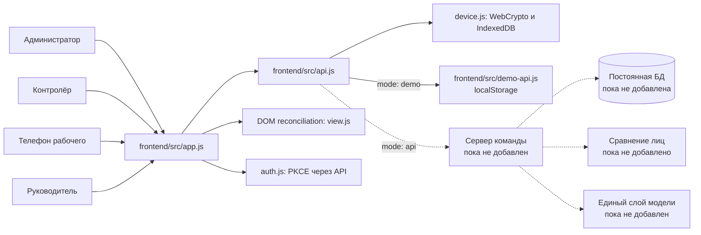

# Устройство фронтенда

`app.js` строит экраны, хранит временное состояние вкладки и передаёт действия в `api.js`. `api.js` выбирает демоадаптер или HTTP-адаптер по `config.js`. `auth.js` запускает PKCE только для операторов через предложенные серверные auth-endpoints; их реализация ещё нужна. `device.js` подписывает запросы рабочего и сохраняет неизвлекаемый ключ в IndexedDB; device-v1 требует согласования. Старый `webauthn.js` не импортируется приложением. `demo-api.js` нужен только для разработки интерфейса: его результат прохода не является проверкой личности. Он не попадает в серверный режим.

В Docker статические файлы отдаёт Nginx от пользователя без прав root на порту 8080. При запуске контейнера `docker/entrypoint.sh` создаёт браузерный `config.js`; при `API_UPSTREAM` добавляет прокси `/api/*` на адрес бэкенда внутри Docker-сети. Решение о проходе по-прежнему должен принимать отдельный бэкенд. GitHub Pages использует исходный `config.js` и публикует только деморежим.

В режиме API контролёр создаёт одноразовый запрос, рабочий подтверждает его ключом устройства, проходная отправляет снимок, а сервер возвращает разрешение или отказ. Фронт не передаёт серверу поля `verified`, `match` или `allowed`. Сервер должен независимо проверить подпись, связь человека/попытки/направления, срок, повтор и совпадение лица с эталоном до изменения смены.

Руководитель получает готовые серверные агрегаты для обстановки, зон, маршрутов и табеля. Метрика зон в интерфейсе — число принятых точек геолокации. Фронт только отображает значения. Помощник вызывается через API сервера; модель не вызывается из браузера и не должна придумывать числа. Точные форматы запросов перечислены в [frontend-api.md](frontend-api.md).

GitHub Pages публикует только `frontend/dist/pages/`, созданный `scripts/build-pages.mjs`. В опубликованный артефакт не входят материалы кейса, фотографии персонала, навыки агента и документация. Текущий Pages-сценарий допускает только `mode: "demo"` и завершает сборку ошибкой при другом режиме. Это защищает от случайной публикации неработающего API-режима как готового продукта.
